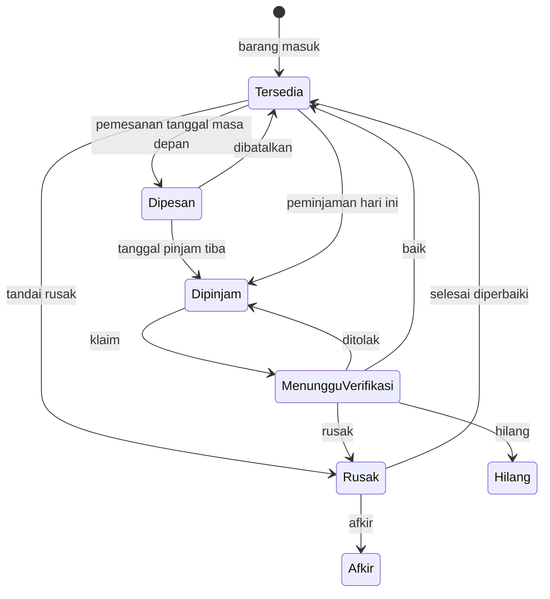
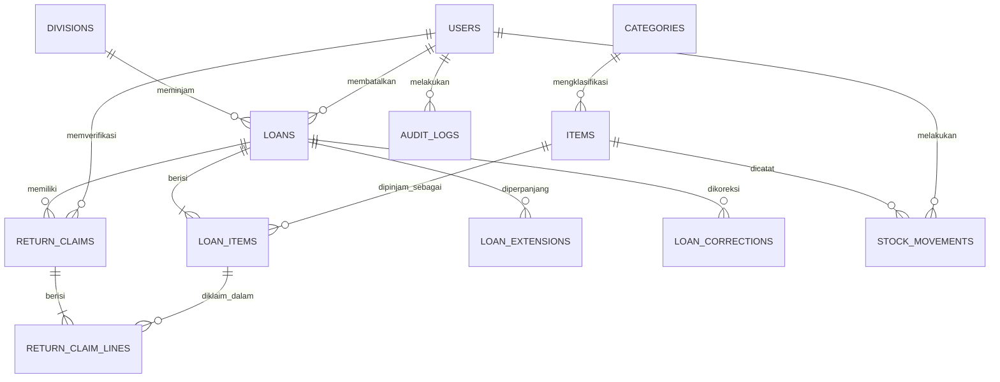

# DESAIN: Sistem Peminjaman & Inventaris Barang Tim IT

| | |
|---|---|
| **Versi** | 1.0 (mengikuti PRD v1.0) |
| **Tanggal** | 22 Oktober 2026 |
| **Dokumen induk** | [`PRD.md`](PRD.md). Kode `FR-xx`, `D-x`, `K-x`, `T-xx` merujuk ke sana |
| **Stack** | Laravel 13 (API JSON), PHP 8.4, MySQL 8.4 InnoDB, Vue + Vite + Tailwind CSS |

Daftar isi: 1 Arsitektur · 2 Aturan bisnis · 3 Model stok · 4 Status peminjaman · 5 Skema database · 6 Penyesuaian Laravel · 7 Transaksi dan Service · 8 API · 9 Struktur folder · 10 UI · 11 Operasional database · 12 Contoh perhitungan

Tanda **[K]** berarti keputusan terbuka (lihat PRD bagian 15). Agent tidak boleh memutuskannya sendiri.

---

## 1. Arsitektur

Dua project dalam satu repo, hanya berkomunikasi lewat JSON. Hanya backend yang mengakses MySQL.

```
Browser kiosk / admin
   │  JSON (axios, cookie sesi, CSRF)
   ▼
frontend/  (Vue, Vite, Tailwind)  ── proxy dev: /api, /sanctum ──►  backend/  (Laravel API)
                                                                      Route → Middleware → Controller (tipis)
                                                                      → Form Request (validasi) → Service (aturan bisnis, transaksi)
                                                                      → Model Eloquent → MySQL 8.4 (localhost)
```

| Lapisan | Folder | Bertanggung jawab atas | Tidak boleh |
|---|---|---|---|
| Frontend | `frontend/` | Layout, navigasi, tabel dan filter, form, modal, toast, badge, tampilan cetak, responsif | Menghitung stok atau status, memutuskan boleh/tidaknya aksi, menjadi satu-satunya penjaga akses |
| Backend | `backend/` | Autentikasi, validasi, aturan bisnis, transaksi, status turunan, buku besar, audit, laporan PDF | Menghasilkan HTML tampilan |

Tiga prinsip:

1. **Server pemilik logika.** Frontend hanya menampilkan dan mengirim niat. Tombol yang tidak berlaku disembunyikan, tetapi server tetap menolak aksi tidak sah.
2. **Satu operasi tulis = satu transaksi.** Pengecekan dan perubahan dalam transaksi yang sama.
3. **Stok punya buku besar.** Setiap perubahan `total`, `tersedia`, atau `rusak` menulis satu baris `stock_movements`. Angka di `items` selalu dapat diverifikasi ulang darinya.

Dev: backend `php artisan serve` (port 8000), frontend `npm run dev` (port 5173) dengan proxy Vite untuk `/api` dan `/sanctum` agar browser melihat satu alamat (tidak ada masalah CORS atau cookie lintas alamat). Produksi: **[K-4]**.

## 2. Aturan bisnis

Dilanggar berarti ada bug. Setiap aturan hanya didefinisikan di sini.

| ID | Aturan |
|---|---|
| **BR-01** | **Invarian stok.** Per barang: `tersedia + rusak + dipinjam + menunggu_verifikasi = total`, semua ≥ 0, `dipinjam` sudah termasuk unit yang dipesan |
| **BR-02** | Peminjaman atau pemesanan mengurangi `tersedia` saat transaksi dibuat (bukan saat tanggal pinjam tiba, D-10). Jumlah tidak boleh melebihi `tersedia`. Divalidasi server |
| **BR-03** | Klaim pengembalian **tidak mengubah** `total`, `tersedia`, maupun `rusak`. Unit berpindah dari Dipinjam ke Menunggu Verifikasi |
| **BR-04** | Jumlah klaim per barang tidak boleh melebihi **sisa** = `qty_dipinjam − menunggu − terverifikasi(baik+rusak+hilang)`. Unit yang **ditolak** tidak dihitung sebagai terverifikasi, jadi kembali menjadi sisa. Divalidasi server saat transaksi. Klaim hanya bila `tanggal_pinjam ≤ hari ini`: pemesanan belum mulai tidak dapat diklaim, hanya dibatalkan |
| **BR-05** | Verifikasi membagi tiap baris klaim ke empat hasil: **baik** (`tersedia +`), **rusak** (`rusak +`), **hilang** (`total −`), **ditolak** (kembali ke Dipinjam). Jumlah keempatnya sama dengan jumlah baris klaim |
| **BR-06** | Bila hasil berbeda dari kondisi yang dilaporkan, atau ada unit ditolak, **catatan admin wajib** |
| **BR-07** | Klaim yang sudah diverifikasi tidak dapat diverifikasi lagi (409) |
| **BR-08** | Kondisi "hilang" baru mengurangi `total` setelah verifikasi, bukan saat klaim |
| **BR-09** | Perbaikan: `rusak −n, tersedia +n`. Afkir: `rusak −n, total −n`, alasan wajib. `n` tidak melebihi `rusak` |
| **BR-10** | **Keterlambatan.** Terlambat bila masih ada unit belum diklaim dan hari ini > batas kembali. Hari terlambat = selisih hari kalender (Asia/Jakarta). Saat klaim dikirim, hari terlambat **dibekukan** pada klaim. Bila klaim ditolak, hitungan berjalan lagi dari batas kembali |
| **BR-11** | **Perpanjangan oleh peminjam** hanya bila: (a) masih ada unit belum diklaim, (b) hari ini ≤ batas kembali, (c) perpanjangan sebelumnya < `maks_perpanjangan`, (d) tambahan 1 sampai `maks_hari_per_perpanjangan` hari, (e) `tanggal_pinjam ≤ hari ini`, (f) semua barang belum diklaim bertanda `boleh_diperpanjang` |
| **BR-12** | Batas kembali baru = **batas kembali saat ini + tambahan hari** (bukan dari hari ini). Berlaku untuk semua unit yang belum diklaim |
| **BR-13** | **Perpanjangan oleh admin** tanpa kuota, boleh untuk yang terlambat, **alasan wajib**, tercatat dengan pelaku admin |
| **BR-14** | Barang tidak dapat dihapus (soft-delete) selama ada unit Dipinjam atau Menunggu Verifikasi. Bila `rusak > 0`, selesaikan dulu lewat perbaikan atau afkir |
| **BR-15** | Penyesuaian total oleh admin wajib beralasan dan tidak boleh membuat `tersedia` negatif |
| **BR-16** | Koreksi peminjaman oleh admin (nama, divisi, telepon, batas kembali, tanggal pinjam, jumlah item) wajib beralasan dan tercatat sebagai riwayat. Jumlah item hanya dapat dikoreksi bila belum ada klaim pada barang itu, efeknya ke stok dicatat |
| **BR-17** | **Kode pinjam** dibuat server, acak kriptografis (`random_int`), format `PJM-XXXXXX`, dari 31 karakter tak ambigu (huruf kecuali I, L, O, dan angka 2–9), sekitar 887 juta kombinasi. **Kode klaim** terpisah, format `KMB-XXXXXX`, alfabet sama. Kode dinormalkan ke huruf besar saat dibuat dan dicari |
| **BR-18** | Kiosk hanya menampilkan data milik kode yang dimasukkan. Telepon tidak pernah tampil di kiosk. Kode dikirim di badan permintaan, bukan URL. Percobaan gagal dibatasi: `kiosk_lookup_maks_gagal` gagal beruntun mengunci lookup selama `kiosk_lookup_kunci_menit` **[K-6]** |
| **BR-19** | Sesi admin berakhir otomatis setelah `sesi_idle_menit` tanpa aktivitas, ditegakkan server **[K-7]**. Tidak ada registrasi publik |
| **BR-20** | Setiap transaksi tulis dari kiosk membawa **kunci idempotensi** (UUID dari form). Permintaan ulang dengan kunci sama tidak membuat transaksi kedua dan mengembalikan hasil lama |
| **BR-21** | Tanggal disimpan `YYYY-MM-DD` zona Asia/Jakarta. Waktu kejadian disimpan UTC |
| **BR-22** | Barang yang sama tidak boleh muncul dua kali dalam satu form. Minimal satu barang per peminjaman |
| **BR-23** | `tanggal_pinjam` ≥ hari ini dan ≤ hari ini + `maks_booking_hari`. `batas_kembali` ≥ `tanggal_pinjam` dan ≤ `tanggal_pinjam + maks_durasi_awal_hari` |
| **BR-24** | **Pembatalan oleh peminjam**: hanya bila hari ini < `tanggal_pinjam` dan belum dibatalkan. Efek: `tersedia +n`, status Dibatalkan, tercatat di buku besar |
| **BR-25** | **Pembatalan oleh admin**: selama belum ada klaim pada peminjaman itu. Alasan wajib. Efek sama dengan BR-24 |
| **BR-26** | Pemesanan tidak dapat diperpanjang. Untuk mengganti tanggal, batalkan lalu pesan ulang |
| **BR-27** | Divisi dipilih dari daftar divisi aktif. Tidak dihapus, hanya dinonaktifkan |
| **BR-28** | Kategori dipilih dari daftar kategori aktif. Setiap barang wajib punya kategori. Tidak dihapus, hanya dinonaktifkan |
| **BR-29** | Kondisi barang diturunkan dari stok: Baik (`rusak = 0`), Sebagian rusak (`0 < rusak < total`), Semua rusak (`rusak = total` dan `tersedia = 0`). Bukan kolom tersimpan |
| **BR-30** | Tipe peminjam wajib: `karyawan` atau `magang` (label Karyawan, Magang). Tidak memengaruhi kuota, durasi, atau aturan lain |
| **BR-31** | Katalog kiosk dapat difilter kategori memakai daftar kategori aktif yang sama dengan admin |
| **BR-32** | Laporan admin dapat difilter atau dikelompokkan berdasarkan kategori barang dan tipe peminjam |
| **BR-33** | Barang tidak dapat dihapus bila kategorinya dinonaktifkan. Untuk menonaktifkan kategori, semua barang aktif di dalamnya harus dipindah ke kategori lain dulu |
| **BR-34** | Admin dapat menandai `n` unit tersedia sebagai rusak (hitung fisik atau temuan kerusakan): `tersedia −n, rusak +n, total` tetap. `n` bulat positif dan ≤ `tersedia`. Alasan wajib. Satu mutasi `TANDAI_RUSAK` |

### Parameter yang dapat diatur admin (tabel `settings`)

| Kunci | Bawaan | Arti | Pengguna |
|---|---|---|---|
| `maks_durasi_awal_hari` | 7 | Rentang maksimal batas kembali dari tanggal pinjam | Server, kiosk |
| `maks_perpanjangan` | 2 | Jumlah perpanjangan self-service | Server, kiosk |
| `maks_hari_per_perpanjangan` | 7 | Maksimum tambahan hari per perpanjangan | Server, kiosk |
| `maks_booking_hari` | 7 | Seberapa jauh ke depan boleh memesan | Server, kiosk |
| `sesi_idle_menit` | 15 | Idle admin sebelum sesi berakhir | Server saja |
| `kiosk_idle_detik` | 60 | Idle kiosk sebelum kembali ke beranda | Kiosk |
| `kiosk_lookup_maks_gagal` | 5 | Gagal beruntun sebelum lookup dikunci | Server saja |
| `kiosk_lookup_kunci_menit` | 5 | Lama penguncian | Server saja |

Batas pinjam maksimal tanpa admin: 7 + (2 × 7) = 21 hari. Tinjau setelah sebulan: bila lebih dari sepertiga peminjaman selalu memakai kuota penuh, naikkan `maks_durasi_awal_hari`.

## 3. Model stok

### 3.1 Perjalanan unit



### 3.2 Yang disimpan dan yang dihitung

| Keadaan | Sumber |
|---|---|
| `tersedia`, `rusak`, `total` | Kolom `items` |
| Menunggu Verifikasi | `SUM(return_claim_lines.qty)` pada klaim berstatus `menunggu` |
| Dipinjam (termasuk Dipesan) | `qty_dipinjam − menunggu − terverifikasi(baik+rusak+hilang)` per `loan_items`, pada peminjaman yang belum dibatalkan. Dipesan = `tanggal_pinjam > hari_ini`, tanpa penghitung terpisah |

Invarian yang diperiksa tes dan perintah `inventaris:periksa-invarian`:

```
tersedia + rusak + dipinjam + menunggu_verifikasi = total      (semua ≥ 0)
items.total    = SUM(stock_movements.delta_total)
items.tersedia = SUM(stock_movements.delta_tersedia)
items.rusak    = SUM(stock_movements.delta_rusak)
```

### 3.3 Efek operasi terhadap stok

| Operasi | total | tersedia | rusak | Jenis buku besar |
|---|---|---|---|---|
| Barang baru / tambah stok | +n | +n | – | `TAMBAH_STOK` |
| Kurangi stok | −n | −n | – | `KURANG_STOK` |
| Peminjaman atau pemesanan dibuat | – | −n | – | `PINJAM` |
| Tandai tersedia menjadi rusak (BR-34) | – | −n | +n | `TANDAI_RUSAK` |
| Koreksi jumlah pinjaman | – | ±n | – | `KOREKSI_PINJAM` |
| Peminjaman dibatalkan | – | +n | – | `BATAL_PINJAM` |
| Klaim dikirim | – | – | – | tidak ada (BR-03) |
| Verifikasi baik | – | +n | – | `VERIFIKASI_BAIK` |
| Verifikasi rusak | – | – | +n | `VERIFIKASI_RUSAK` |
| Verifikasi hilang | −n | – | – | `VERIFIKASI_HILANG` |
| Verifikasi ditolak | – | – | – | tidak ada (unit kembali ke Dipinjam) |
| Selesai diperbaiki | – | +n | −n | `PERBAIKAN_SELESAI` |
| Afkir | −n | – | −n | `AFKIR` |

## 4. Status peminjaman (diturunkan, tidak disimpan)

Dihitung dari dua angka per peminjaman: **O** = unit yang masih di tangan peminjam (belum diklaim, termasuk unit yang klaimnya ditolak), **P** = unit menunggu verifikasi.

Definisi per `loan_item`:
- `diklaim_menunggu` = Σ `qty` baris klaim berstatus `menunggu`
- `terverifikasi` = Σ (`qty_baik + qty_rusak + qty_hilang`) baris klaim berstatus `diverifikasi`
- `sisa (O per barang)` = `qty_dipinjam − diklaim_menunggu − terverifikasi`
- O peminjaman = Σ sisa semua barang, P = Σ `diklaim_menunggu`

Pemeriksaan berurutan dari atas, berhenti di yang pertama cocok:

| # | Pertanyaan | Hasil |
|---|---|---|
| 1 | `dibatalkan_pada` terisi? | **Dibatalkan** |
| 2 | `tanggal_pinjam > hari_ini`? | **Dipesan** |
| 3 | O = 0 dan P = 0? | **Selesai** |
| 4 | O = 0? | **Menunggu Verifikasi** |
| 5 | `hari_ini > batas_kembali`? | **Terlambat** (badge merah dengan jumlah hari) |
| 6 | (selain itu) | **Dipinjam** |

| Lencana | Syarat |
|---|---|
| Sebagian | Ada unit yang sudah diklaim atau diverifikasi, tetapi O > 0 |
| Ada klaim menunggu | P > 0 |
| Diperpanjang n× | Ada n baris di `loan_extensions` |
| Ada catatan | `catatan_peminjam` atau `catatan_admin` tidak kosong pada klaim mana pun |

**Hari terlambat:** peminjaman dengan O > 0 → `MAX(0, hari_ini − batas_kembali)`. Klaim → nilai beku di `return_claims.hari_terlambat`. Selama O = 0 dan P > 0, keterlambatan tidak bertambah (D-8).

### Transisi yang diizinkan

| Kejadian | Hanya boleh bila | Hasil |
|---|---|---|
| Peminjaman dibuat | tanggal pinjam = hari ini, stok cukup | Dipinjam |
| Pemesanan dibuat | tanggal pinjam ≤ hari ini + `maks_booking_hari`, stok cukup | Dipesan, stok ditahan |
| Tanggal pinjam tiba | otomatis oleh waktu | Dipesan → Dipinjam |
| Batas kembali terlewati | otomatis oleh waktu | Dipinjam → Terlambat |
| Pembatalan peminjam | hari ini < tanggal pinjam | Dibatalkan |
| Pembatalan admin | belum ada klaim, alasan diisi | Dibatalkan |
| Klaim | tanggal pinjam ≤ hari ini, jumlah ≤ sisa | Unit pindah ke menunggu. Bila O = 0 → Menunggu Verifikasi |
| Verifikasi | klaim berstatus menunggu | Stok sesuai hasil. Semua selesai → Selesai. Ditolak → Dipinjam atau Terlambat |
| Perpanjangan peminjam | BR-11 terpenuhi | Batas kembali bertambah |
| Perpanjangan admin | O > 0, alasan diisi | Boleh untuk yang terlambat |
| Perpanjangan pemesanan | tidak pernah (BR-26) | Batalkan lalu pesan ulang |
| Koreksi admin | alasan diisi, jumlah hanya bila belum ada klaim pada barang itu | Tercatat di `loan_corrections` |

Tidak ada proses terjadwal. Dipesan dan Terlambat diturunkan dari perbandingan tanggal saat data dibaca.

## 5. Skema database

13 tabel domain ditambah tabel bawaan Laravel `sessions`, `cache`, `cache_locks`, dan `migrations`. `jobs` dan `password_reset_tokens` dihapus dari migration (tidak ada antrean, tidak ada reset lewat email).

Aturan umum:
- Semua FK `RESTRICT` (tanpa `CASCADE`). Data yang pernah dipakai transaksi tidak dihapus fisik: barang soft-delete, divisi, kategori, dan akun dinonaktifkan.
- InnoDB, `utf8mb4`, collation `utf8mb4_unicode_ci`.
- ID dan FK: `INT UNSIGNED`. Waktu kejadian `DATETIME` UTC dengan default `CURRENT_TIMESTAMP`. Tanggal kalender `DATE`.
- Model domain memakai `$timestamps = false` dan kolom Bahasa Indonesia (`dibuat_pada`, `nama`, `tersedia`).
- Tabel append-only (tanda ◆): aplikasi tidak melakukan `UPDATE` atau `DELETE`.
- `CHECK` dibuat lewat `DB::statement` di migration bila Blueprint tidak menyediakannya (verifikasi di dokumentasi Laravel 13). MySQL < 8.0.16 mengabaikan `CHECK` diam-diam, jadi pemeriksaan versi wajib.

```
users            id PK · name V100 · email V190 UNIQUE · password V255 (hash) · aktif TINYINT(1) =1 CHECK(0,1)
                 · login_terakhir DT null · dibuat_pada DT
divisions        id PK · nama V100 UNIQUE · aktif TINYINT(1) =1 CHECK(0,1)
categories       id PK · nama V100 UNIQUE · aktif TINYINT(1) =1 CHECK(0,1)      (seed: "Tanpa Kategori")
settings         kunci V60 PK · nilai V255 · diubah_pada DT (auto update)         (seed: 8 kunci)
items            id PK · nama V150 · deskripsi TEXT null · kategori_id FK→categories NOT NULL
                 · total INT CHECK≥0 · tersedia INT CHECK≥0 · rusak INT =0 CHECK≥0
                 · boleh_diperpanjang TINYINT(1) =1 CHECK(0,1)
                 · dibuat_pada · diubah_pada (auto update) · dihapus_pada DT null (soft-delete)
                 · nama_aktif V150 GENERATED STORED = IF(dihapus_pada IS NULL, nama, NULL) UNIQUE
                 · CHECK (tersedia + rusak <= total)    -- selisihnya = dipinjam + menunggu
loans            id PK · kode_pinjam V12 UNIQUE · nama_peminjam V100 · division_id FK→divisions
                 · tipe_peminjam ENUM('karyawan','magang') · telepon V20 null
                 · tanggal_pinjam DATE · batas_kembali_awal DATE · batas_kembali DATE
                 · idempotency_key CHAR(36) null UNIQUE · dibuat_pada
                 · dibatalkan_pada DT null · alasan_batal V500 null · dibatalkan_oleh FK→users null
                 · CHECK (batas_kembali >= tanggal_pinjam) · INDEX(batas_kembali), INDEX(tipe_peminjam)
loan_items       id PK · loan_id FK · item_id FK · qty_dipinjam INT CHECK≥1 · UNIQUE(loan_id, item_id)
return_claims    id PK · kode_klaim V12 UNIQUE · loan_id FK · catatan_peminjam V500 null · diklaim_pada
                 · hari_terlambat INT =0 CHECK≥0 · status ENUM('menunggu','diverifikasi') ='menunggu'
                 · diverifikasi_oleh FK→users null · diverifikasi_pada DT null · catatan_admin V500 null
                 · idempotency_key CHAR(36) null UNIQUE · INDEX(loan_id), INDEX(status, diklaim_pada)
return_claim_lines id PK · claim_id FK · loan_item_id FK · kondisi_dilaporkan ENUM('baik','rusak','hilang')
                 · qty INT CHECK≥1 · qty_baik, qty_rusak, qty_hilang, qty_ditolak INT null
                 · UNIQUE(claim_id, loan_item_id, kondisi_dilaporkan) · INDEX(loan_item_id)
                 · CHECK (keempat qty_* NULL semua) OR (semua ≥ 0 AND jumlahnya = qty)       -- BR-05
◆ loan_extensions id PK · loan_id FK · batas_lama DATE · batas_baru DATE · tambahan_hari INT CHECK≥1
                 · alasan V500 null · diajukan_oleh ENUM('peminjam','admin') · user_id FK null · dibuat_pada
◆ loan_corrections id PK · loan_id FK · kolom V50 · nilai_lama V500 null · nilai_baru V500 null
                 · alasan V500 NOT NULL · user_id FK NOT NULL · dibuat_pada
◆ stock_movements id PK · item_id FK · jenis ENUM(TAMBAH_STOK, KURANG_STOK, PINJAM, KOREKSI_PINJAM,
                 BATAL_PINJAM, VERIFIKASI_BAIK, VERIFIKASI_RUSAK, VERIFIKASI_HILANG, PERBAIKAN_SELESAI,
                 AFKIR, TANDAI_RUSAK) · delta_total, delta_tersedia, delta_rusak INT =0
                 · ref_tipe V30 null · ref_id INT null · user_id FK null (null = aksi kiosk)
                 · catatan V500 null · dibuat_pada · INDEX(item_id, dibuat_pada)
◆ audit_logs     id PK · user_id FK null · aksi V60 · entitas V60 · entitas_id INT null
                 · detail JSON null (tanpa password atau token) · dibuat_pada · INDEX(entitas, entitas_id)
```

### Relasi



Catatan: `return_claim_lines` menyimpan **laporan peminjam** (`kondisi_dilaporkan`, `qty`) dan **hasil verifikasi** (`qty_baik/rusak/hilang/ditolak`, kosong sebelum diverifikasi). Satu baris laporan dapat dipecah admin ke beberapa hasil. `user_id` bernilai NULL untuk aksi kiosk. Empat hal yang `CHECK` tidak bisa jamin, sehingga dijaga kode dan tes: keempat kolom hasil terisi semua atau kosong semua; klaim ≤ sisa (BR-04); versi MySQL; kecocokan `items` dengan buku besar.

## 6. Penyesuaian khusus Laravel

| Hal | Keputusan | Alasan |
|---|---|---|
| Login admin | Sanctum mode SPA (`statefulApi()` di `bootstrap/app.php`), sesi di tabel `sessions` (`SESSION_DRIVER=database`), cookie `httpOnly`, `SameSite=Strict`. `SESSION_SECURE_COOKIE=false` karena jaringan lokal memakai HTTP | Satu frontend milik sendiri, tidak ada token di browser |
| Sesi idle **[K-7]** | `SESSION_LIFETIME` hanya batas atas (mis. 120). Middleware `SesiIdle` menyimpan waktu aktivitas terakhir di sesi dan mengeluarkan admin bila selisihnya melebihi `settings.sesi_idle_menit` | `SESSION_LIFETIME` dibaca saat boot dari `.env`, sedangkan PRD mengizinkan nilai diubah dari UI. Alternatif: nilai tetap dari `.env` dan hapus dari UI |
| CSRF di kiosk | Rute kiosk berada di grup API yang stateful, jadi POST kiosk juga butuh CSRF. Frontend memanggil `GET /sanctum/csrf-cookie` saat aplikasi dimuat dan mengirim header `X-XSRF-TOKEN` (Axios melakukannya otomatis bila `withXSRFToken` aktif) | Tanpa itu form kiosk gagal 419 |
| Konfigurasi publik kiosk | Endpoint `GET /api/kiosk/config` mengembalikan hanya: `maks_durasi_awal_hari`, `maks_booking_hari`, `maks_perpanjangan`, `maks_hari_per_perpanjangan`, `kiosk_idle_detik` | Kiosk butuh nilai ini untuk form dan idle reset. Parameter keamanan tidak ikut dibuka |
| Zona waktu | `app.timezone = UTC`, koneksi DB `+00:00`, server MySQL `default-time-zone = '+00:00'`. `Support\Tanggal::hariIni()` mengembalikan tanggal Asia/Jakarta (`Y-m-d`). Tampilan dikonversi ke Asia/Jakarta | Satu sumber "hari ini" agar status dan keterlambatan konsisten |
| Kolom `DATE` | Cast `'date:Y-m-d'` atau string. Selisih hari selalu antara dua tanggal `Y-m-d` yang di-parse di zona yang sama. Jangan serialisasi Carbon penuh untuk tanggal kalender | Mencegah hari bergeser satu hari (merusak BR-10 dan BR-21) |
| Timestamp domain | `$timestamps = false`, nilai bawaan dari database. Panggil `refresh()` bila butuh nilai default setelah `create()` | Selaras dengan nama kolom Indonesia |
| Kode acak | `random_int()` pada alfabet 31 karakter | BR-17 |
| Kode status | 422 validasi (bawaan Laravel), 401, 403, 404, 409, 419, 429. Semua galat berbentuk `{ "kode", "pesan", "errors"? }` lewat penangan galat seragam | Frontend menangani satu bentuk |
| Otorisasi | Satu level admin: seluruh rute admin memakai `auth:sanctum` + middleware akun aktif. Policy tidak dipakai | Tidak ada peran lain yang perlu dibedakan |
| Akun database | `app_inventaris` butuh `DELETE` pada `sessions`, `cache`, `cache_locks` (sesi dan pembatas laju menghapus baris kedaluwarsa). Migration dijalankan dengan akun `migrator` lewat override env | Lihat bagian 11 |
| Idempotensi | Kunci disimpan di `loans.idempotency_key` dan `return_claims.idempotency_key` (UNIQUE) | BR-20 |
| Pemeriksaan lingkungan | Perintah `inventaris:periksa-lingkungan` (versi MySQL ≥ 8.0.16, `sql_mode` memuat `STRICT_TRANS_TABLES`, charset `utf8mb4`). Dijalankan manual dan saat deploy, tidak pada setiap request | FR-S-03 |

## 7. Transaksi dan Service

Semua operasi multi-baris berjalan dalam `DB::transaction()` dengan 3 percobaan ulang untuk deadlock (1213). Batas waktu kunci (1205) diperlakukan sama: verifikasi apakah framework mengulangnya otomatis, bila tidak bungkus manual. Urutan penguncian selalu sama: baris `loans` (atau klaim) lebih dulu, lalu baris `items` menurut `id` menaik. Urutan tetap mencegah dua transaksi saling menunggu. Jumlah baris terdampak pembaruan bersyarat dipakai untuk mendeteksi konflik.

| Service | Tanggung jawab |
|---|---|
| `PeminjamanService` | Buat peminjaman dan pemesanan |
| `KlaimService` | Buat klaim pengembalian |
| `VerifikasiService` | Proses verifikasi |
| `PerpanjanganService` | Perpanjangan peminjam dan admin |
| `PembatalanService` | Pembatalan peminjam dan admin |
| `KoreksiService` | Koreksi peminjaman |
| `StokService` | Penyesuaian total, tandai rusak, perbaikan, afkir |
| `StatusPeminjaman` | Turunan status, O dan P, lencana, hari terlambat (murni baca) |
| `LaporanService` | Data laporan PDF |
| `BukuBesarStok` (di `Support/`) | **Satu-satunya** jalur penulisan `stock_movements`, menjamin satu baris per perubahan |

### 7.1 Buat peminjaman atau pemesanan
1. Bila `idempotency_key` sudah ada, kembalikan hasil lama.
2. Validasi: nama, divisi aktif, tipe peminjam, telepon, tanggal (BR-23), minimal satu barang, tanpa duplikat (BR-22).
3. Per barang, urut `id` menaik: `UPDATE items SET tersedia = tersedia - :q WHERE id = :id AND dihapus_pada IS NULL AND tersedia >= :q`. Bila tidak ada baris terdampak, batalkan dengan 409 dan sebut barangnya.
4. Buat kode (BR-17), ulangi bila bentrok UNIQUE.
5. Simpan `loans`, `loan_items`, satu mutasi `PINJAM` per barang.

### 7.2 Buat klaim
1. Cek idempotensi. Kunci baris `loans` berdasarkan kode (`lockForUpdate`).
2. Tolak bila dibatalkan atau `tanggal_pinjam > hari_ini`. Hitung sisa tiap `loan_items` (BR-04).
3. Validasi: total per barang ≤ sisa, minimal 1 unit, catatan ≤ 500 karakter.
4. `hari_terlambat = MAX(0, hari_ini − batas_kembali)`, dibekukan.
5. Simpan `return_claims` (status `menunggu`) dan `return_claim_lines`. **Tidak ada penulisan ke `items`.**

Alasan mengunci `loans`: hitungan sisa membaca beberapa baris. Tanpa kunci, dua klaim yang sama-sama melihat sisa 1 bisa sama-sama lolos.

### 7.3 Verifikasi klaim
1. Kunci klaim dan `items` terkait (urut `id`). `UPDATE return_claims SET status='diverifikasi', ... WHERE id = :id AND status = 'menunggu'`. Tidak ada baris terdampak → 409 (BR-07).
2. Tiap baris: empat hasil ≥ 0 dan berjumlah `qty`.
3. Hasil berbeda dari `kondisi_dilaporkan` atau ada yang ditolak, tanpa `catatan_admin` → tolak (BR-06).
4. Per barang: `tersedia += Σbaik`, `rusak += Σrusak`, `total -= Σhilang`.
5. Tulis mutasi per jenis hasil dan audit. Periksa BR-01 sebelum commit (gagal berarti rollback).

Aksi cepat "Setujui sesuai laporan": frontend mengisi empat hasil sama dengan laporan, tetap melalui endpoint verifikasi yang sama.

### 7.4 Perpanjangan
Peminjam: kunci `loans`, hitung O dan kuota. Tolak bila O = 0, atau salah satu syarat BR-11 gagal (sebut barang yang tidak boleh diperpanjang di pesan). `batas_baru = batas_kembali + tambahan_hari`. Simpan `loan_extensions` (`diajukan_oleh='peminjam'`) dan audit. Admin: lewati syarat kuota dan keterlambatan, alasan wajib, `diajukan_oleh='admin'` plus `user_id`.

### 7.5 Stok: tandai rusak, perbaikan, afkir, penyesuaian
Kunci `items`. Tolak bila `n` bukan bulat positif atau melebihi nilai asal (tandai rusak: `tersedia`, perbaikan dan afkir: `rusak`, kurangi stok: tidak boleh membuat `tersedia` negatif). Terapkan efek (bagian 3.3), tulis satu mutasi dan audit, tegakkan BR-01.

### 7.6 Koreksi
Tolak koreksi jumlah bila barang itu sudah punya klaim. Kunci `items`, hitung selisih `Δ = qty_baru − qty_lama` (bila `Δ > 0`, syarat `tersedia ≥ Δ`). `tersedia -= Δ`, tulis `KOREKSI_PINJAM`, `loan_corrections` (alasan wajib), audit.

### 7.7 Pembatalan
Peminjam: tolak bila sudah dibatalkan atau `tanggal_pinjam <= hari_ini`. Admin: tolak bila ada klaim, alasan wajib. Kunci `loans`, `UPDATE loans SET dibatalkan_pada = ... WHERE id = :id AND dibatalkan_pada IS NULL` (tidak ada baris terdampak → 409). Per `loan_items`: `tersedia += qty_dipinjam`, mutasi `BATAL_PINJAM`, audit.

## 8. API

Semua JSON, awalan `/api`. Nama kolom JSON `snake_case`. Galat: `{ "kode": "...", "pesan": "...", "errors": { "kolom": ["pesan"] } }` (`errors` hanya untuk 422).

| Kode | Arti |
|---|---|
| 401 | Belum login atau sesi berakhir |
| 403 | Dilarang (mis. akun nonaktif) |
| 404 | Tidak ditemukan |
| 409 | Konflik: stok berubah, klaim sudah diproses, kunci idempotensi bentrok dengan isi berbeda |
| 419 | CSRF kedaluwarsa |
| 422 | Validasi gagal |
| 429 | Terlalu banyak percobaan |

### 8.1 Kiosk (publik, dibatasi laju)

| Method | Path | Fungsi | FR |
|---|---|---|---|
| GET | `/api/kiosk/config` | Parameter publik (bagian 6) | K-02, K-10 |
| GET | `/api/kiosk/items?q=&kategori=` | Katalog: nama dan `tersedia` saja | K-01 |
| GET | `/api/kiosk/categories` | Kategori aktif | K-01 |
| GET | `/api/kiosk/divisions` | Divisi aktif | K-02 |
| POST | `/api/kiosk/loans` | Buat peminjaman atau pemesanan, kembalikan kode | K-02, K-03 |
| POST | `/api/kiosk/loans/lookup` | Kartu peminjaman dari `{ kode }` | K-04, K-09 |
| POST | `/api/kiosk/return-claims` | Klaim `{ kode, lines[], catatan, idempotency_key }` | K-05, K-06 |
| POST | `/api/kiosk/extensions` | Perpanjang `{ kode, tambahan_hari, alasan }` | K-07, K-08 |
| POST | `/api/kiosk/loans/cancel` | Batalkan pemesanan `{ kode }` | K-12 |

Kode selalu di badan permintaan, bukan URL, agar tidak masuk log akses.

### 8.2 Admin

| Method | Path | Fungsi | FR |
|---|---|---|---|
| GET | `/sanctum/csrf-cookie` | Cookie CSRF (bawaan Sanctum) | A-01 |
| POST | `/api/auth/login` | Masuk | A-01 |
| POST | `/api/auth/logout` | Keluar | A-01 |
| GET | `/api/auth/me` | Info sesi | A-01 |
| POST | `/api/auth/change-password` | Ganti password sendiri | A-02 |
| GET, POST, PATCH | `/api/admin/users` | Kelola akun admin | A-02 |
| GET, POST, PUT, DELETE | `/api/admin/items` | Kelola barang (DELETE = soft-delete) | A-03 |
| POST | `/api/admin/items/{id}/stock-adjustments` | Tambah atau kurangi stok | A-10 |
| POST | `/api/admin/items/{id}/mark-damaged` | Tandai tersedia menjadi rusak | A-09 |
| GET | `/api/admin/repairs` | Barang dengan `rusak > 0` | A-09 |
| POST | `/api/admin/items/{id}/repair-complete` | Selesai diperbaiki | A-09 |
| POST | `/api/admin/items/{id}/write-off` | Afkir | A-09 |
| GET | `/api/admin/summary` | Angka dasbor dan jumlah antrean | A-15, A-19 |
| GET | `/api/admin/loans` | Daftar dengan filter | A-05 |
| GET | `/api/admin/loans/{id}` | Detail dan lini masa | A-06 |
| PATCH | `/api/admin/loans/{id}` | Koreksi | A-07 |
| POST | `/api/admin/loans/{id}/extensions` | Perpanjangan admin | A-08 |
| POST | `/api/admin/loans/{id}/cancel` | Pembatalan admin | A-17 |
| GET, POST, PATCH | `/api/admin/divisions` | Kelola divisi | A-16 |
| GET, POST, PATCH | `/api/admin/categories` | Kelola kategori | A-18 |
| GET | `/api/admin/return-claims?status=menunggu` | Antrean verifikasi | A-04 |
| GET | `/api/admin/return-claims/{id}` | Detail klaim | A-04 |
| POST | `/api/admin/return-claims/{id}/verify` | Verifikasi `{ lines[], catatan_admin }` | A-04 |
| GET | `/api/admin/reports/{jenis}.pdf` | `rekap`, `belum-kembali`, `stok`, `pengembalian` | A-11 |
| GET, PUT | `/api/admin/settings` | Parameter | A-12 |
| GET | `/api/admin/audit-logs` | Jejak audit | A-13 |

Filter `GET /api/admin/loans`: `status`, `barang`, `kategori`, `tipe_peminjam`, `divisi`, `dari`, `sampai`, `q`, `ada_catatan`, `ada_kerusakan`, `belum_kembali`, `page`, `page_size`.

Bentuk JSON yang sebenarnya dicatat di bagian ini oleh agent saat tiap endpoint selesai (todo 3.11).

## 9. Struktur folder

```
backend/
  app/Console/Commands/     BuatAdmin, ResetPasswordAdmin, PeriksaInvarian, PeriksaLingkungan
  app/Http/Controllers/Api/ Auth/, Kiosk/, Admin/          (tipis, hanya meneruskan ke Service)
  app/Http/Requests/        Kiosk/, Admin/                  (satu Form Request per aksi)
  app/Http/Resources/       bentuk JSON per entitas
  app/Http/Middleware/      AkunAktif, SesiIdle
  app/Models/               User, Division, Category, Item, Loan, LoanItem, ReturnClaim, ReturnClaimLine,
                            LoanExtension, LoanCorrection, StockMovement, AuditLog, Setting
  app/Services/             PeminjamanService, KlaimService, VerifikasiService, PerpanjanganService,
                            PembatalanService, KoreksiService, StokService, StatusPeminjaman, LaporanService
  app/Support/              Tanggal, KodeAcak, BukuBesarStok
  database/                 migrations/, seeders/, factories/
  routes/                   api.php, web.php, console.php
  tests/                    Feature/, Unit/
frontend/
  src/api/                  klien axios dan fungsi per endpoint
  src/components/           tabel, badge, modal, form, toast
  src/layouts/              LayoutKiosk, LayoutAdmin, LayoutLogin
  src/pages/kiosk/          halaman kiosk
  src/pages/admin/          halaman admin
  src/router/  src/stores/  rute dan guard; status login dan notifikasi
docs/                       PRD.md, DESAIN.md
AGENTS.md  todo.md
```

Nama berkas di atas adalah rancangan awal dan disesuaikan saat scaffold dibuat.

## 10. UI

### 10.1 Prinsip

| Prinsip | Penerapan |
|---|---|
| Satu tugas per layar di kiosk | Tombol besar, target sentuh ≥ 44 px |
| Kode pinjam tidak masuk URL | Kode hanya di badan permintaan dan memori aplikasi (store tanpa persist), dihapus saat kembali ke beranda atau idle. Memuat ulang halaman kartu mengembalikan ke layar Cek |
| Server memutuskan | Frontend menyembunyikan tombol tak berlaku, server tetap menolak |
| Setiap tombol berfungsi | Tidak ada tombol dekoratif. Tindakan berisiko memakai modal konfirmasi |
| Status konsisten | Satu komponen badge dipakai di semua tabel dan kartu |
| Admin berorientasi tabel | Pencarian, filter, pagination di setiap daftar. Detail dibuka lewat baris |

### 10.2 Layar kiosk

| Path | Layar | Isi utama | API |
|---|---|---|---|
| `/` | Beranda | Tiga tombol besar: Lihat katalog, Pinjam barang, Cek atau kembalikan | – |
| `/katalog` | Katalog | Pencarian, filter kategori, kartu barang (nama, stok). Stok 0 diberi tanda dan tidak bisa dipilih | items, categories |
| `/pinjam` | Form pinjam | Keranjang barang dan jumlah, nama, divisi, tipe peminjam, telepon, tanggal pinjam, batas kembali, ringkasan. Tombol Kirim nonaktif saat memproses | config, divisions, POST loans |
| `/pinjam/selesai` | Struk dan kode | Kode besar, daftar barang, tanggal, tombol Cetak dan Selesai, pengingat mencatat kode | respons POST |
| `/cek` | Cek peminjaman | Satu kolom kode. Pesan galat umum bila salah. Pesan terkunci setelah batas | lookup |
| `/cek/kartu` | Kartu peminjaman | Badge status dan lencana, batas kembali, sisa hari atau hari terlambat, barang dengan sisa, riwayat klaim dengan hasil dan catatan admin. Tombol Klaim, Perpanjang, Batalkan hanya bila berlaku | respons lookup |
| `/klaim` | Klaim pengembalian | Per barang jumlah dan kondisi, catatan, ringkasan sebelum kirim | POST return-claims |
| `/klaim/selesai` | Bukti klaim | Kode klaim dan instruksi menyerahkan barang | respons POST |
| `/perpanjang` | Perpanjangan | Pilihan tambahan hari, alasan opsional, batas kembali baru | POST extensions |
| `/perpanjang/selesai` | Bukti perpanjangan | Batas baru dan jumlah perpanjangan | respons POST |
| `/batal` | Batalkan pemesanan | Modal konfirmasi dengan ringkasan | POST loans/cancel |

Kartu peminjaman adalah pusat: klaim, perpanjangan, dan pembatalan semuanya berawal dari sana dengan kode yang sama.

### 10.3 Layar admin

| Path | Layar | Isi utama |
|---|---|---|
| `/admin/login` | Login | Email, password, pesan galat umum, pesan bila dibatasi |
| `/admin` | Dasbor | Kartu angka (dipinjam, terlambat, menunggu verifikasi, stok rusak), daftar terlambat, polling 30 detik |
| `/admin/barang` | Barang | Tabel dengan pencarian dan filter kategori. Aksi: tambah, ubah, hapus, penyesuaian stok |
| `/admin/barang/baru`, `/admin/barang/:id/ubah` | Form barang | Nama, deskripsi, kategori, total awal, boleh diperpanjang |
| `/admin/peminjaman` | Daftar peminjaman | Semua filter (bagian 8.2), pagination |
| `/admin/peminjaman/:id` | Detail | Data peminjam, barang dan sisa, lini masa, klaim, perpanjangan. Aksi: Koreksi, Perpanjang, Batalkan |
| `/admin/verifikasi` | Antrean | Klaim menunggu, tertua di atas |
| `/admin/verifikasi/:id` | Verifikasi | Per baris empat kolom hasil yang harus berjumlah sama dengan klaim, selisih tampil, Simpan aktif hanya bila selisih nol. Aksi cepat "Setujui sesuai laporan". Catatan wajib sesuai BR-06 dengan petunjuk bahwa catatan terlihat peminjam. Modal konfirmasi |
| `/admin/stok-rusak` | Stok rusak | Barang `rusak > 0`. Aksi: tandai rusak (dari daftar barang), selesai diperbaiki, afkir |
| `/admin/laporan` | Laporan | Pilih jenis dan filter, unduh PDF |
| `/admin/kategori`, `/admin/divisi` | Master data | Tabel, tambah, ubah nama, nonaktifkan |
| `/admin/pengaturan` | Pengaturan | Delapan parameter dengan rentang nilai |
| `/admin/akun` | Akun admin | Daftar, tambah, nonaktifkan, ganti password sendiri |
| `/admin/audit` | Jejak audit | Tabel dengan filter entitas dan tanggal, hanya baca |
| `/403`, `/404`, `/419` | Galat | Pesan ramah tanpa informasi internal. 419: "Sesi berakhir, silakan masuk lagi" |

Navigasi: sidebar kiri di layar lebar, menu geser di tablet dan ponsel. Grup: Dasbor · Peminjaman (Daftar, Antrean verifikasi dengan lencana) · Inventaris (Barang, Stok rusak dengan lencana, Kategori) · Master data (Divisi) · Laporan · Sistem (Pengaturan, Akun, Jejak audit). Navbar atas: nama admin, ganti password, Keluar.

### 10.4 Komponen Vue yang dipakai ulang

`LayoutKiosk`, `LayoutAdmin`, `LayoutLogin` · `Sidebar`, `Navbar` · `TombolBesar` · `KartuBarang` · `TabelData` (urutan, pagination, mode kartu di layar sempit) · `FilterBar` · `BadgeStatus`, `BadgeLencana` · `InputJumlah` (pencacah dengan batas) · `InputKode` (huruf besar otomatis) · `FormField` (label, input, galat per kolom) · `ModalKonfirmasi` · `NotifikasiToast` (`aria-live`) · `StatusKosong`, `Memuat` (skeleton), `PesanGalat` · `LiniMasa` · `StrukCetak` · `KartuAngka`.

### 10.5 Token desain

Warna netral (putih dan abu muda) dengan satu aksen biru untuk tombol utama. Satu keluarga sans-serif, **font sistem** agar tidak bergantung internet di jaringan kantor. Ukuran dasar 18 px di kiosk, 14–16 px di admin. Sudut membulat sedang, bayangan minimal, spasi kelipatan 4 px bawaan Tailwind. Tanpa mode gelap. Satu pustaka ikon, dipilih saat scaffold frontend.

| Status | Warna | Teks |
|---|---|---|
| Dipesan | Ungu | Dipesan |
| Dipinjam | Biru | Dipinjam |
| Terlambat | Merah | Terlambat, dengan jumlah hari |
| Menunggu Verifikasi | Kuning | Menunggu Verifikasi |
| Selesai | Hijau | Selesai |
| Dibatalkan | Abu gelap | Dibatalkan |

Warna tidak pernah menjadi satu-satunya penanda, selalu disertai teks.

### 10.6 Keadaan layar dan aturan formulir

| Keadaan | Tampilan |
|---|---|
| Kosong | Pesan singkat dan tindakan lanjut ("Belum ada peminjaman") |
| Memuat | Skeleton untuk tabel. Tombol kirim berindikator dan nonaktif |
| 422 | Pesan di bawah setiap kolom, ringkasan di atas, fokus ke kolom pertama yang salah |
| 409 | Pesan spesifik (mis. sisa stok berubah menjadi n), data dimuat ulang |
| 429 | "Terlalu banyak percobaan, coba lagi dalam n menit" |
| 401 / 419 | Diarahkan ke login dengan pesan, bukan layar kosong |
| 500 atau jaringan | Pesan umum dan tombol Coba lagi, tanpa informasi internal |
| Sukses | Toast hijau ±4 detik di admin. Layar bukti di kiosk |

- Validasi frontend hanya kemudahan. Server yang menentukan sah atau tidak.
- Kunci idempotensi (UUID) dibuat saat form dibuka dan dikirim bersama data.
- Pencacah jumlah dibatasi stok tersedia, server tetap memeriksa ulang.
- Pada verifikasi, selisih antara jumlah klaim dan jumlah yang sudah dibagi ke empat hasil ditampilkan, Simpan aktif hanya bila nol.
- Cetak: struk, bukti, dan laporan memakai stylesheet cetak tanpa sidebar dan navbar.
- Aksesibilitas: kontras memadai, fokus keyboard terlihat, label pada semua input, toast lewat `aria-live`.

### 10.7 Kriteria penerimaan UI

| ID | Skenario | Lulus jika |
|---|---|---|
| UI-01 | Peminjam menyelesaikan peminjaman di layar sentuh | Seluruh alur selesai tanpa menu tersembunyi, keyboard hanya untuk teks |
| UI-02 | Tombol Kirim ditekan berulang cepat | Hanya satu transaksi |
| UI-03 | Kode diperiksa di URL, riwayat browser, log akses | Tidak ditemukan |
| UI-04 | Satu peminjaman dilihat di kartu kiosk, tabel admin, detail | Badge status identik |
| UI-05 | Layar dibuka pada 360 px dan 768 px | Tidak ada konten terpotong, tabel admin terbaca |
| UI-06 | Struk dan laporan dicetak | Tanpa elemen navigasi |
| UI-07 | Setiap daftar dibuka saat kosong dan saat memuat | Keadaan kosong dan memuat tampil |
| UI-08 | Sesi admin dibiarkan lewat batas idle lalu dipakai | Pesan sesi berakhir dan diarahkan ke login |

## 11. Operasional database

### 11.1 Lingkungan

| Lingkungan | Database | Lokasi | Catatan |
|---|---|---|---|
| Pengembangan | `inventaris_it_dev` | Laptop pengembang | Boleh dikosongkan kapan saja |
| Tes | `inventaris_it_test` | Laptop pengembang | Dibuat ulang tiap suite. Aplikasi menolak menjalankan tes bila nama database tidak berakhiran `_test` |
| Produksi | `inventaris_it` | PC server kantor | Tidak pernah dipakai untuk eksperimen. **`migrate:fresh` dilarang di sini** |

Versi minimum MySQL 8.0.16. MySQL berjalan di PC yang sama dengan aplikasi dan tidak menerima koneksi jaringan.

### 11.2 Akun dan hak

| Akun | Hak | Dipakai oleh |
|---|---|---|
| `root` | Semua. **Kata sandi wajib diisi** (bawaan Laragon kosong) | Administrator saat pemasangan dan pemulihan |
| `app_inventaris` | `SELECT`, `INSERT`, `UPDATE` pada database aplikasi. `DELETE` hanya pada `sessions`, `cache`, `cache_locks`. Pada `_test`: DML penuh | Aplikasi sehari-hari dan runner tes |
| `migrator` | `ALL PRIVILEGES` pada database aplikasi dan `_dev`. Pada `_test`: hak DDL agar runner dapat membuat ulang | `php artisan migrate` lewat override env |
| `backup` | `SELECT`, `SHOW VIEW`, `TRIGGER`, `LOCK TABLES` | Tugas backup terjadwal |

Migration dijalankan dengan akun `migrator`, misalnya `DB_USERNAME=migrator DB_PASSWORD=... php artisan migrate`. `GRANT` tingkat tabel gagal bila tabelnya belum ada: jalankan migration lebih dulu, baru `GRANT`.

**Aturan operasional:**
1. Tabel `items`, `loans`, `loan_items`, `return_claims`, `return_claim_lines`, dan `stock_movements` **tidak boleh diubah lewat alat SQL manual** di produksi. Perubahan manual melewati buku besar dan merusak BR-01. Koreksi lewat aplikasi.
2. Alat SQL hanya untuk membaca.
3. Kata sandi tidak ditulis di kode, README, atau argumen perintah. Semua di `.env` atau berkas konfigurasi di luar Git.

### 11.3 Konfigurasi

`my.ini`:

```ini
[mysqld]
bind-address         = 127.0.0.1
character-set-server = utf8mb4
collation-server     = utf8mb4_unicode_ci
default-time-zone    = '+00:00'
```

Pastikan `SELECT @@sql_mode;` memuat `STRICT_TRANS_TABLES` (bawaan MySQL 8) dan firewall tidak membuka port 3306.

`backend/.env.example` (dikomit, `.env` sungguhan tidak):

```
APP_ENV=local
APP_DEBUG=true
APP_TIMEZONE=UTC
APP_LOCALE=id
DB_CONNECTION=mysql
DB_HOST=127.0.0.1
DB_PORT=3306
DB_DATABASE=inventaris_it_dev
DB_USERNAME=app_inventaris
DB_PASSWORD=
SESSION_DRIVER=database
SESSION_LIFETIME=120
SESSION_SAME_SITE=strict
SESSION_SECURE_COOKIE=false
SANCTUM_STATEFUL_DOMAINS=localhost:5173,127.0.0.1:5173
```

Di operasional: `APP_ENV=production`, `APP_DEBUG=false`, `DB_DATABASE=inventaris_it`, alamat frontend di `SANCTUM_STATEFUL_DOMAINS`. Bila K-7 memilih nilai tetap, `SESSION_LIFETIME=15`.

### 11.4 Backup dan pemulihan

Backup harian lewat Windows Task Scheduler di luar jam kerja. Kredensial di berkas konfigurasi terpisah dengan hak akses dibatasi, bukan di argumen perintah.

```powershell
$ts = Get-Date -Format 'yyyyMMdd_HHmm'
& mysqldump --defaults-extra-file=C:\inventaris\backup.cnf `
    --single-transaction --no-tablespaces --routines `
    --default-character-set=utf8mb4 `
    --result-file="D:\backup\inventaris_it_$ts.sql" inventaris_it
```

`--single-transaction` membuat backup konsisten tanpa mengunci tabel dan tanpa mematikan server. Simpan 14 salinan terakhir dan **satu salinan di perangkat lain** (backup di PC yang sama ikut hilang bila PC rusak). `*.sql` dan `.env` masuk `.gitignore`. Ambil backup manual sebelum setiap migration di produksi.

Pemulihan, dilatih sebelum go-live dan tiap kuartal: buat database `inventaris_it_restore` (`utf8mb4`, `utf8mb4_unicode_ci`), muat dump ke dalamnya, lalu jalankan `inventaris:periksa-invarian` terhadapnya. Backup yang belum pernah dipulihkan belum bisa disebut backup.

## 12. Contoh perhitungan

Barang **Kabel HDMI**: `total = 10`, `tersedia = 10`, `rusak = 0`. Batas awal peminjaman Hari 7.

| Hari | Kejadian | total | tersedia | rusak | Dipinjam | Menunggu | BR-01 |
|---|---|---|---|---|---|---|---|
| 0 | Budi meminjam 3 unit | 10 | 7 | 0 | 3 | 0 | 7+0+3+0 = 10 ✓ |
| 5 | Budi klaim 2 unit (baik) | 10 | 7 | 0 | 1 | 2 | 7+0+1+2 = 10 ✓ |
| 6 | Admin verifikasi: 1 baik, 1 rusak | 10 | 8 | 1 | 1 | 0 | 8+1+1+0 = 10 ✓ |
| 6 | Budi memperpanjang 3 hari | 10 | 8 | 1 | 1 | 0 | Batas baru Hari 10 (7 + 3) ✓ |
| 11 | Budi klaim 1 unit terakhir, terlambat 1 hari | 10 | 8 | 1 | 0 | 1 | 8+1+0+1 = 10 ✓ |
| 12 | Admin verifikasi: hilang (catatan admin terisi) | 9 | 8 | 1 | 0 | 0 | 8+1+0+0 = 9 ✓ |
| 13 | 1 unit rusak selesai diperbaiki | 9 | 9 | 0 | 0 | 0 | 9+0+0+0 = 9 ✓ |

Yang diperlihatkan: klaim Hari 5 tidak mengubah `tersedia` (D-1). Unit rusak Hari 6 tidak masuk `tersedia` sampai Hari 13 (D-2). Perpanjangan dihitung dari batas lama, bukan dari Hari 6. Keterlambatan 1 hari dibekukan pada klaim Hari 11 dan tidak bertambah sampai verifikasi Hari 12 (D-8). Di Hari 12 admin mengubah "baik" menjadi "hilang", sehingga catatan admin wajib (BR-06).

**Variasi pemesanan.** Budi memesan di Hari 0 untuk mulai Hari 3: `tersedia` sudah 7 sejak Hari 0, status Dipesan sampai Hari 3. Dibatalkan di Hari 2, `tersedia` kembali 10 dan status Dibatalkan. Bila tidak dibatalkan, batas kembali dihitung dari Hari 3 (paling jauh Hari 10), dan klaim baru boleh dibuat mulai Hari 3.
